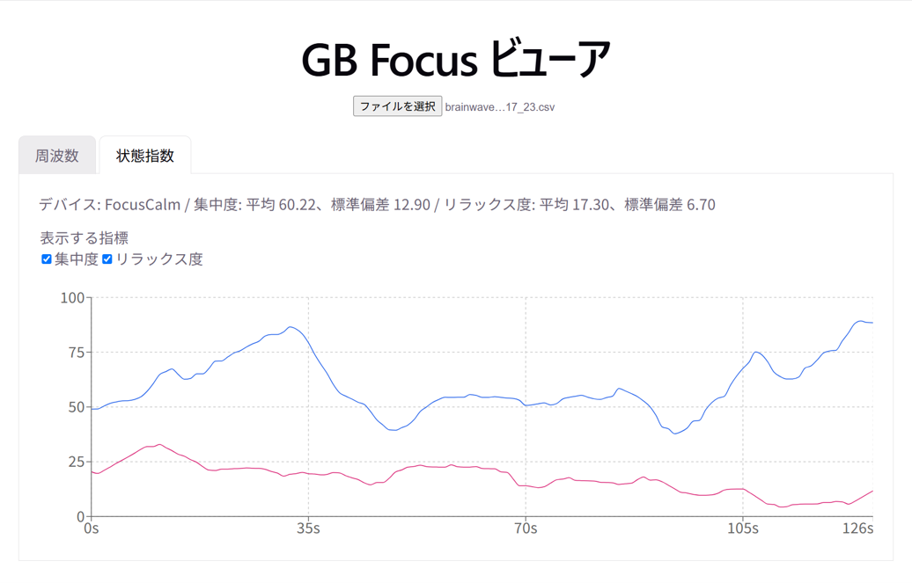

# GB Focus Web Viewer

GB Focus（GOODBRAIN）の計測 CSV をブラウザーで読み込み、脳波の状態指数や周波数帯の変化をグラフで確認する Web アプリです。



## 主な機能

- GB Focus の CSV を読み込んで時系列グラフを表示
- 集中度・リラックス度の表示と平均値・標準偏差の確認
- α波・β波・δ波・θ波・γ波の表示切り替え
- CSV に含まれるデータに応じて OxyZen / FocusCalm を判定

## 動作環境

- Node.js と npm
- CSV を表示するための最新の Web ブラウザー

## セットアップと起動

```bash
npm install
npm run dev
```

ターミナルに表示された URL（通常は `http://localhost:5173`）をブラウザーで開いてください。

## 使い方

1. GB Focus から書き出した CSV を用意します。
2. アプリ画面のファイル選択欄から CSV を選びます。
3. 「状態指数」と「周波数」のタブを切り替え、チェックボックスで表示する指標を選びます。

CSV はブラウザー内で読み込まれます。OxyZen と FocusCalm では CSV に含まれる指標が異なります。FocusCalm では、落ち着き度・眠気・脈拍・血中酸素飽和度は利用できません。生波形（`eeg`）の表示には対応していません。

## 開発用コマンド

| コマンド | 内容 |
|---|---|
| `npm run dev` | 開発サーバーを起動 |
| `npm run build` | 本番用ファイルを `dist/` にビルド |
| `npm run preview` | ビルドしたアプリをローカルでプレビュー |
| `npm run lint` | Oxlint でコードをチェック |

## 技術スタック

- React
- Vite
- Recharts

## チュートリアル

CSV の構造や、CSV ビューアを段階的に作る手順については[チュートリアル](./docs/gb-focus-viewer-tutorial.md)を参照してください。
