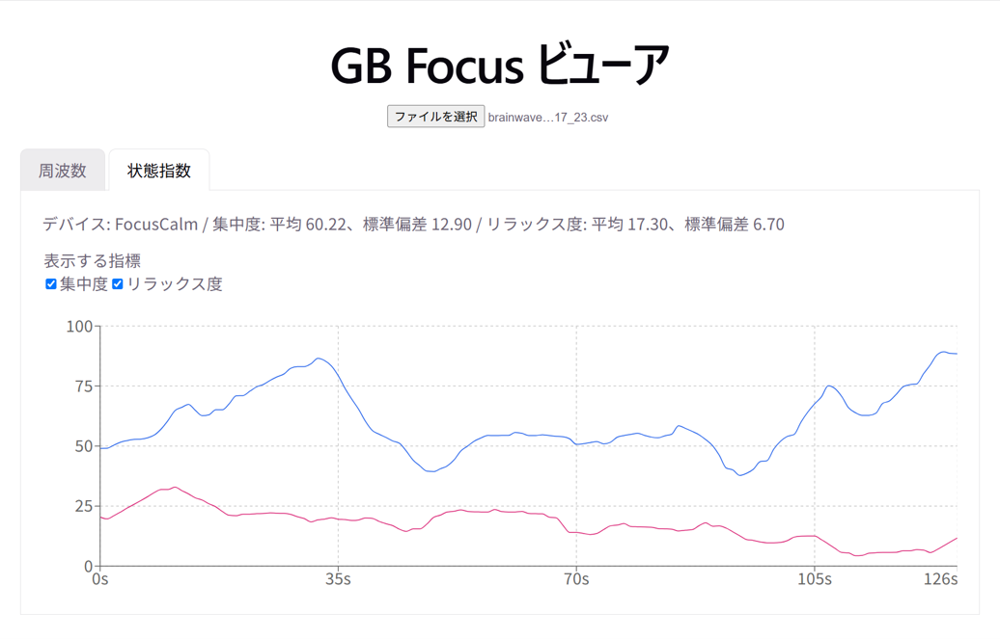
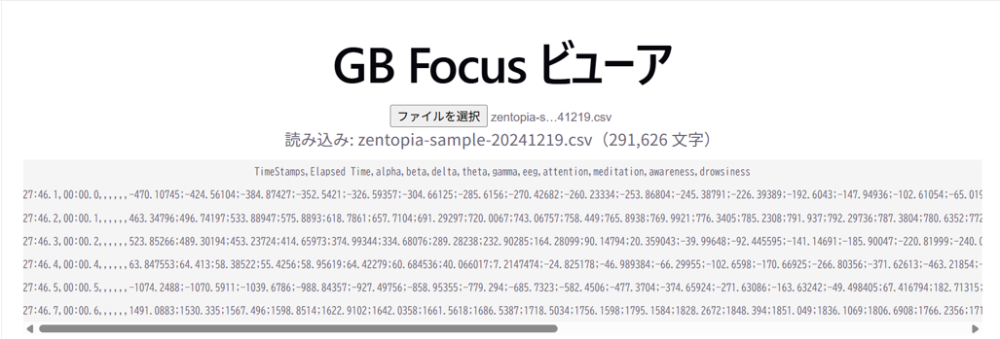
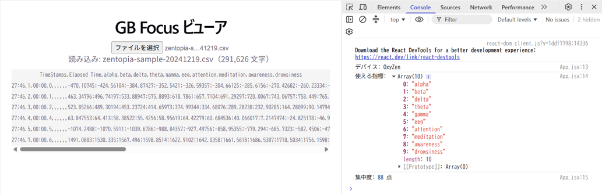
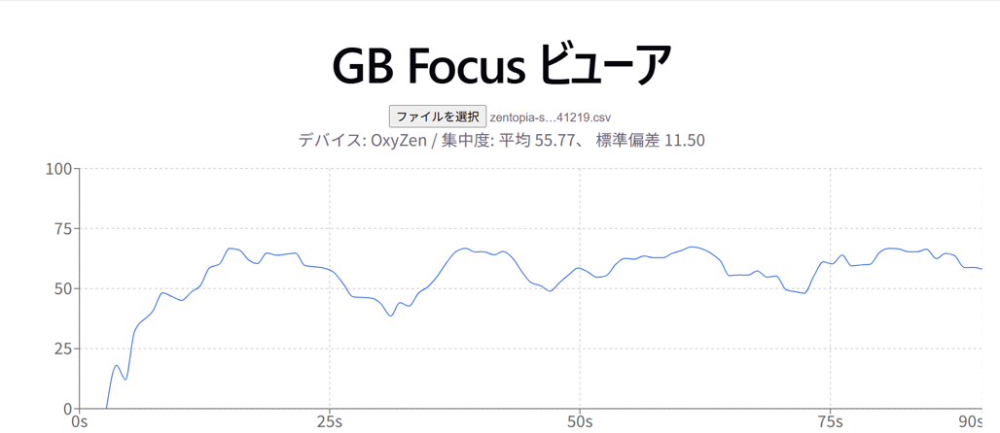
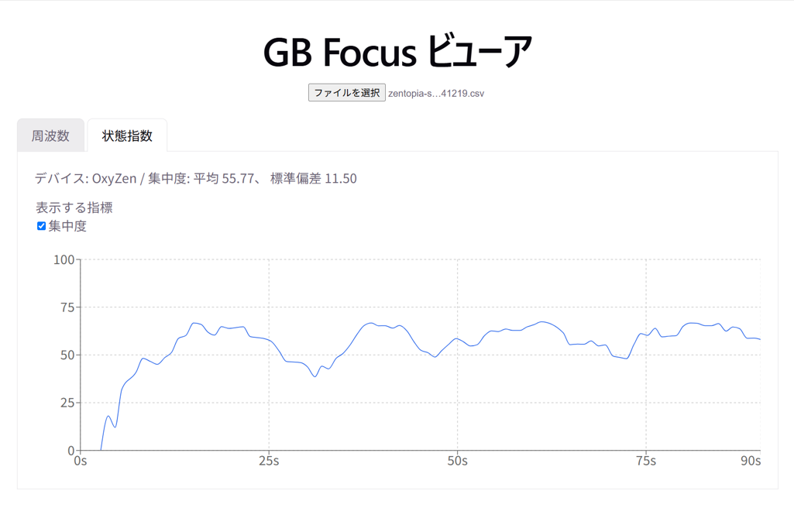
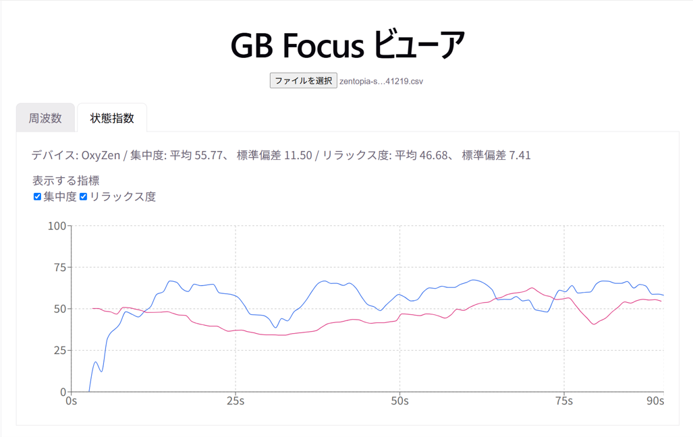
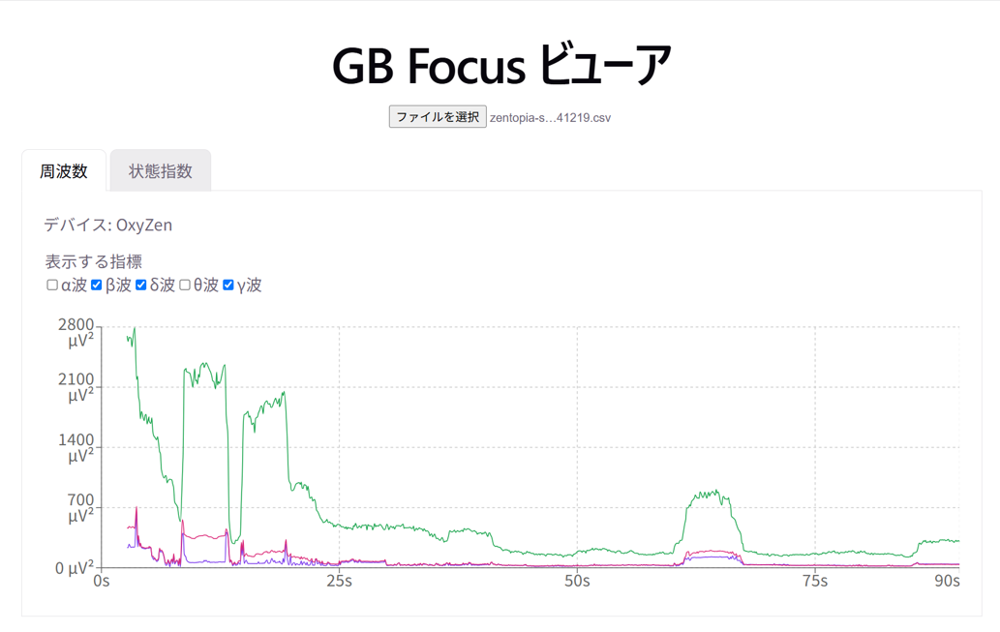

# GB Focus CSV ビューアを作る — チュートリアル

このチュートリアルは AI が生成したチュートリアルを、Good Brain Web担当 宮島 が確認し、加筆しました。

GB Focus（GOODBRAIN の計測アプリ）が書き出した CSV を、ブラウザで読み込んでグラフにする Web アプリを作ります。
OxyZen を用いて取得したcsvをもとにコードを作成していますが、FocusCalmでも利用可能です。
ただし、FocusCalmの場合、落ち着き度（awareness）、眠気（drowsiness）、脈拍（pulse rate）、血中酸素飽和度（spo2）は利用できません。（そもそも出力されていないため）

**このドキュメントの読者**: React を少し触ったことがある人。脳波の知識は不要です。
**所要時間の目安**: Step 1〜3 で半日、Step 4 まで含めて2〜3日。

---

## 0. 何を作るのか

ローカルの CSV をドラッグ&ドロップすると、指標が時系列グラフで見られるアプリ。



### 段階

**一気に全部作らないでください。** 各 Step が終わったら必ず動かして見せてください。

| Step | やること | 終わったら見えるもの |
|---|---|---|
| **1** | Vite で React を立ち上げ、CSV をファイル選択で読み込んでテキスト表示 | 「読めた」 |
| **2** | CSV をパースして、指標ごとの点数をコンソールに出す | 「中身が分かった」 |
| **3** | 集中度を折れ線グラフにする | **ここが最初のゴール** |
| **4** | 指標の切り替え、複数ファイルの比較、統計値 | 実用 |

---

## 1. ⚠️ 最初に知るべきこと — この CSV は「1行1レコード」ではない

**ここを誤解すると全部おかしくなります。他の何より先に読んでください。**

普通の CSV はこうだと思いますよね:

```csv
時刻,集中度,リラックス度
0.0,70.6,42.4
1.0,68.2,45.1     ← 1行に全部入っている
```

**GB Focus の CSV は違います。** 指標ごとに**記録される速さが違う**ので、
**それぞれ別の行に、バラバラに書かれています。** 実データの先頭はこうです:

```csv
TimeStamps,Elapsed Time,alpha,beta,delta,theta,gamma,attention,eeg,pulse rate,spo2,drowsiness,meditation,awareness,
2026-06-09 16:01:59.942,00:00:00.000,,,,,,70.6,,,,,,,          ← attention だけ
2026-06-09 16:01:59.943,00:00:00.000,12.9,33.0,71.6,...,,-3.2;-3.7;...,67.0,96.6,,,,   ← バンド+eeg+脈拍+SpO2
2026-06-09 16:02:00.180,00:00:00.238,,,,,,,,,,3.0,,,           ← drowsiness だけ
```

**空欄だらけなのが正常です。壊れていません。**

実際に数えるとこうなっています（4分の計測1本、全3170行）:

| 指標 | 値が入っている行数 | だいたいの速さ |
|---|---|---|
| `attention`（集中度） | **261** | 約1秒に1回 |
| `meditation`（リラックス度） | **261** | 約1秒に1回 |
| `awareness`（おちつき度） | 261 | 約1秒に1回 |
| `drowsiness`（眠気度） | 417 | 約2秒に3回 |
| `alpha` `beta` `delta` `theta` `gamma`（バンド） | **2086** | 約1秒に8〜9回 |
| `pulse rate` `spo2` | 266 | 約1秒に1回 |
| `eeg`（生波形） | 2086行 × 各30個 = **62,580点** | 約300Hz |

### だからコードはこう書く

**「N行目のデータ」を取ろうとしない。「その列の、値が入っている行だけ」を取る。**

```js
// ❌ こうすると空欄だらけの配列になる
const attention = rows.map((r) => r[7])

// ✅ 列を名前で引いて、数値にならないもの（空欄）を捨てる
const i = header.indexOf('attention')
const attention = rows.map((r) => parseFloat(r[i])).filter(Number.isFinite)
```

### あと2つ、地味にハマるところ

**① 列の順番は保証されていません。** デバイスや書き出し時期で変わります。
**必ず列名で引いてください**（`r[7]` のような位置指定は禁止）。

**② ヘッダの末尾にカンマがあります。**

```
...,meditation,awareness,     ← 最後のカンマ
```

このせいで「名前のない空の列」が1つ増えます。無視してください。

---

## 2. セットアップ

```bash
npm create vite@latest gb-focus-viewer -- --template react
cd gb-focus-viewer
npm install
npm run dev
```

`http://localhost:5173` が開けば OK です。

### グラフのライブラリを選ぶ

**結論から: まずは `recharts` を使ってください。**

```bash
npm install recharts
```

**なぜ d3 ではないか。** d3 は「グラフを描くライブラリ」ではなく「グラフを描くための部品集」で、
軸も線も自分で組み立てます。強力ですが、**最初のグラフが出るまでが遠い**。
recharts は React のコンポーネントとして書けるので、**Step 3 が今日中に終わります。**

ただし**選択には条件があります**。上の表を見返してください:

| 描きたいもの | 点の数 | 向いているもの |
|---|---|---|
| 集中度・リラックス度 | 約260点 | **recharts で十分** |
| バンド（α波・β波…） | 約2,000点 | recharts で描けるが少し重い |
| **生波形（`eeg`）** | **約62,000点** | **recharts では固まる** → 後述 |

recharts は SVG で描くので、点の数だけ DOM 要素が増えます。数万点になると**ブラウザが固まります**。
生波形を描くのは Step 4 以降の課題にして、**まずは集中度から始めてください**（§7 で対処法を書きます）。

> d3 を使いたい気持ちがあるなら止めません。ただし**Step 3 を recharts で1回終わらせてから**にしてください。
> 「動くもの」があると、作り直すときに比較できます。

---

## 3. Step 1 — CSV を読み込む



まずファイルを読んで、中身をそのまま画面に出すところまで。

```jsx
// src/App.jsx
import { useState } from 'react'

export default function App() {
  const [text, setText] = useState('')
  const [fileName, setFileName] = useState('')

  async function handleFile(file) {
    if (!file) return
    setFileName(file.name)
    setText(await file.text())   // File API。これだけで中身が読めます
  }

  return (
    <div style={{ padding: 24, fontFamily: 'sans-serif' }}>
      <h1>GB Focus ビューア</h1>

      <input
        type="file"
        accept=".csv"
        onChange={(e) => handleFile(e.target.files[0])}
      />

      {fileName && <p>読み込み: {fileName}（{text.length.toLocaleString()} 文字）</p>}
      <pre style={{ fontSize: 11, maxHeight: 300, overflow: 'auto', background: '#f5f5f5' }}>
        {text.slice(0, 2000)}
      </pre>
    </div>
  )
}
```

**ここで確認すること**: 空欄だらけの行が見えるはずです。§1 で読んだとおりの形になっていますか？

> **ドラッグ&ドロップにしたい場合**は、`<div>` に `onDragOver={(e) => e.preventDefault()}` と
> `onDrop={(e) => { e.preventDefault(); handleFile(e.dataTransfer.files[0]) }}` を付けます。
> **`onDragOver` で `preventDefault()` を呼ばないと `onDrop` が発火しません**（よくハマります）。

---

## 4. Step 2 — パーサを書く



`src/parseGbFocusCsv.js` を作ります。**このコードは実データで動作確認済みです。**

```js
// src/parseGbFocusCsv.js

/**
 * GB Focus の CSV をパースする。
 * 行は疎（指標ごとに別の行）なので、指標ごとに「値が入っている行」だけを集める。
 */
export function parseGbFocusCsv(text) {
  const lines = text.trim().split(/\r?\n/)
  const header = lines[0].split(',').map((s) => s.trim())
  const rows = lines.slice(1).map((line) => line.split(','))

  const timeIdx = header.indexOf('Elapsed Time')

  // "00:04:04.123" → 244.123（秒）
  const toSeconds = (hms) => {
    if (!hms) return NaN
      const parts = hms.split(':').map(Number)  // この後「:」で分けた後の要素数で分岐
    if (parts.some((part) => !Number.isFinite(part))) return NaN

    //　要素数3 => 「時：分：秒」のとき
    if (parts.length === 3) {
      const [h, m, s] = parts
      return h * 3600 + m * 60 + s
    }

    // 要素数2 => 「分：秒」のとき
    if (parts.length === 2) {
      const [m, s] = parts
      return m * 60 + s
    }

    // それ以外の要素数の時は何も返さない
    return NaN
  }


  /** 指標名を渡すと [{ t: 秒, value: 値 }, ...] を返す */
  const series = (name) => {
    const i = header.indexOf(name)      // ← 位置ではなく名前で引く
    if (i === -1) return []
    const out = []
    for (const r of rows) {
      const v = parseFloat(r[i])
      if (!Number.isFinite(v)) continue // ← 空欄はここで落ちる
      out.push({ t: toSeconds(r[timeIdx]), value: v })
    }
    return out
  }

  // 生波形は1セルに「;」区切りで約30個入っている。約300Hz として時刻を振る。
  const eegIdx = header.indexOf('eeg')
  const eeg = []
  if (eegIdx !== -1) {
    for (const r of rows) {
      const cell = r[eegIdx]
      if (!cell) continue
      const t0 = toSeconds(r[timeIdx])
      const vals = cell.split(';').map(parseFloat).filter(Number.isFinite)
      vals.forEach((v, k) => eeg.push({ t: t0 + k / 300, value: v }))
    }
  }

  const has = (name) => series(name).length > 0
  // OxyZen だけが脈拍・SpO2・おちつき度を持つ
  const device = has('pulse rate') || has('spo2') || has('awareness') ? 'OxyZen' : 'FocusCalm'

  const available = header.filter(
    (h) => h && h !== 'TimeStamps' && h !== 'Elapsed Time' && (h === 'eeg' ? eeg.length > 0 : has(h))
  )

  return { header, device, available, series, eeg }
}
```

App.jsx から呼んで、コンソールで確認します:

```jsx
const parsed = parseGbFocusCsv(await file.text())
console.log('デバイス:', parsed.device)
console.log('使える指標:', parsed.available)
console.log('集中度:', parsed.series('attention').length, '点')
```

**期待される出力**（`sample-data/study/*.csv` の場合）:

```
デバイス: OxyZen
使える指標: ['alpha','beta','delta','theta','gamma','attention','eeg','pulse rate','spo2','drowsiness','meditation','awareness']
集中度: 261 点
```

**CSVの列よりも点が少なくなりましたか？** 同じになっていたら空欄を捨てられていません。§1 に戻ってください。

### なぜ CSV ライブラリを使わないのか

この CSV は**引用符もセル内カンマも無い**ので、`split(',')` で正しく割れます（生波形は `;` 区切りなのでカンマを含みません）。
ライブラリを足す理由が今はありません。**将来フォーマットが変わって困ったら** `papaparse` に置き換えてください。

---

## 5. Step 3 — グラフを描く（最初のゴール）



```jsx
// src/App.jsx
import { useState } from 'react'
import { LineChart, Line, XAxis, YAxis, CartesianGrid, Tooltip, ResponsiveContainer } from 'recharts'
import { parseGbFocusCsv } from './parseGbFocusCsv'

// 平均と標準偏差の算出
function summarizeValues(series) {
  const values = series.map(({ value }) => value)
  if (values.length === 0) return { mean: 0, standardDeviation: 0 }

  const mean = values.reduce((sum, value) => sum + value, 0) / values.length
  const variance = values.reduce((sum, value) => sum + (value - mean) ** 2, 0) / values.length

  return { mean, standardDeviation: Math.sqrt(variance) }
}

export default function App() {
  const [data, setData] = useState(null)

  async function handleFile(file) {
    if (!file) return
    setData(parseGbFocusCsv(await file.text()))
  }

  const attention = data?.series('attention') ?? []
  const attentionSummary = summarizeValues(attention)

  return (
    <div style={{ padding: 24, fontFamily: 'sans-serif' }}>
      <h1>GB Focus ビューア</h1>
      <input type="file" accept=".csv" onChange={(e) => handleFile(e.target.files[0])} />

      {data && (
        <>
          <p>
            デバイス: {data.device} / 集中度: 平均 {attentionSummary.mean.toFixed(2)}、
            標準偏差 {attentionSummary.standardDeviation.toFixed(2)}
          </p>
          <div style={{ width: '100%', height: 320 }}>
            <ResponsiveContainer>
              <LineChart data={attention} margin={{ top: 20, left: 5 }}>
                <CartesianGrid strokeDasharray="3 3" />
                <XAxis
                  dataKey="t"
                  type="number"
                  domain={[0, 'dataMax']}
                  tickFormatter={(t) => `${Math.round(t)}s`}
                />
                <YAxis domain={[0, 100]} />
                <Tooltip
                  labelFormatter={(t) => `${t.toFixed(1)} 秒`}
                  formatter={(v) => [v.toFixed(1), '集中度']}
                />
                {/* dot={false} は必須。260点ぶんの丸を描くと重いし見づらい */}
                <Line
                  type="monotone"
                  dataKey="value"
                  stroke="#2563eb"
                  dot={false}
                  isAnimationActive={false}
                />
              </LineChart>
            </ResponsiveContainer>
          </div>
        </>
      )}
    </div>
  )
}
```

### ここで必ず引っかかるポイント

**X軸が「0,1,2,3…」の連番になってしまう場合**、`XAxis` の指定が足りていません。
`dataKey="t"` **と** `type="number"` の**両方**が必要です。
これが無いと recharts は t を「ラベル文字列」として扱い、**時間の間隔が無視されます**。
指標によって記録の間隔が違う（集中度は1秒おき、バンドは0.12秒おき）ので、ここを間違えると波形の形が変わります。

**縦軸の範囲**: 集中度・リラックス度は 0〜100 なので `domain={[0, 100]}` を固定したほうが読みやすいです。
一方**バンド（α波・β波）は μV² で上限が決まっていない**ので、こちらは `domain={['auto', 'auto']}` にしてください。

---

## 6. Step 4 — 指標を切り替える

`data.available` にその CSV で使える指標名が入っています。チェックボックスを並べて、
選ばれた指標だけ `<Line>` を追加します。**表示名は日本語にしてください**（利用者は英語の列名を知りません）:

```js
const LABELS = {
  attention: '集中度',
  meditation: 'リラックス度',
  awareness: 'おちつき度',
  drowsiness: '眠気度',
  alpha: 'α波', beta: 'β波', delta: 'δ波', theta: 'θ波', gamma: 'γ波',
  'pulse rate': '脈拍', spo2: '血中酸素'
}
```

**注意**: 単位が違う指標を同じ縦軸に重ねないでください。
0〜100 の指標と μV² のバンドを1つのグラフに描くと、**片方が潰れて見えなくなります**。
グラフを分けるか、recharts の `<YAxis yAxisId="right" orientation="right" />` で軸を2本にします。

今回は FocusCalm 用として、リラックス度を集中度のグラフに重ね描きし、
別のグラフにα波、β波、δ波、θ波、γ波を描きます。

### Step 4.1 — 複数の波形を切り替えるための準備

やることリスト
- [ ] 変数"activeTab"で「状態指数」「周波数」タブの切り替え
- [ ] 変数"visibleSeries"でグラフの表示状態の保存
- [ ] 変数"onChange"の状態とチェックボックスの連動
- [ ] 以上の内容を実装した「集中度」を描画



```jsx
// src/App.jsx
import { useState } from 'react'
import { LineChart, Line, XAxis, YAxis, CartesianGrid, Tooltip, ResponsiveContainer } from 'recharts'
import { parseGbFocusCsv } from './parseGbFocusCsv'

// 平均と標準偏差の算出
function summarizeValues(series) {
  const values = series.map(({ value }) => value)
  if (values.length === 0) return { mean: 0, standardDeviation: 0 }

  const mean = values.reduce((sum, value) => sum + value, 0) / values.length
  const variance = values.reduce((sum, value) => sum + (value - mean) ** 2, 0) / values.length

  return { mean, standardDeviation: Math.sqrt(variance) }
}

export default function App() {
  const [data, setData] = useState(null)
  // 表示しているタブの設定
  const [activeTab, setActiveTab] = useState('state')
  // 表示チェックが入っている指標のみ描画
  const [visibleSeries, setVisibleSeries] = useState({
    attention: true,
  })

  async function handleFile(file) {
    if (!file) return
    setData(parseGbFocusCsv(await file.text()))
  }

  const attention = data?.series('attention') ?? []
  const attentionSummary = summarizeValues(attention)

  function toggleSeries(name) {
    setVisibleSeries((current) => ({
      ...current,
      [name]: !current[name],
    }))
  }

  return (
    <div style={{ padding: 24, fontFamily: 'sans-serif' }}>
      <h1>GB Focus ビューア</h1>
      <input type="file" accept=".csv" onChange={(e) => handleFile(e.target.files[0])} />

      {data && (
        <>
          <div className="chart-tabs" role="tablist" aria-label="グラフの種類">
            {/* タブの作成 */}
            <button
              className="chart-tab"
              type="button"
              role="tab"
              aria-selected={activeTab === 'frequency'}
              aria-controls="frequency-panel"
              onClick={() => setActiveTab('frequency')}
            >
              周波数
            </button>
            <button
              className="chart-tab"
              type="button"
              role="tab"
              aria-selected={activeTab === 'state'}
              aria-controls="state-panel"
              onClick={() => setActiveTab('state')}
            >
              状態指数
            </button>
          </div>

          {activeTab === 'frequency' ? (
            {/* 周波数タブを選択した時の挙動 */}
            <section className="chart-panel" id="frequency-panel" role="tabpanel">
              <p>周波数グラフは準備中です。</p>
            </section>
          ) : (
            {/* 状態指数タブを選択した時の挙動 */}
            <section className="chart-panel" id="state-panel" role="tabpanel">
            <p>
              デバイス: {data.device} / 集中度: 平均 {attentionSummary.mean.toFixed(2)}、
              標準偏差 {attentionSummary.standardDeviation.toFixed(2)}
            </p>
              <fieldset className="metric-controls">
                {/* チェックボックス */}
                <legend>表示する指標</legend>
                <label>
                  <input
                    type="checkbox"
                    checked={visibleSeries.attention}
                    onChange={() => toggleSeries('attention')}
                  />
                  集中度
                </label>
              </fieldset>
              <div style={{ width: '100%', height: 320 }}>
                <ResponsiveContainer>
                  <LineChart data={attention} margin={{ top: 20, left: 5 }}>
                    <CartesianGrid strokeDasharray="3 3" />
                    <XAxis
                      dataKey="t"
                      type="number"
                      domain={[0, 'dataMax']}
                      tickFormatter={(t) => `${Math.round(t)}s`}
                    />
                    <YAxis domain={[0, 100]} />
                    <Tooltip
                      labelFormatter={(t) => `${t.toFixed(1)} 秒`}
                      formatter={(v) => [v.toFixed(1), '集中度']}
                    />
                    {/* dot={false} は必須。260点ぶんの丸を描くと重いし見づらい */}
                    {visibleSeries.attention && (
                      <Line
                        type="monotone"
                        dataKey="value"
                        stroke="#2563eb"
                        dot={false}
                        isAnimationActive={false}
                      />
                    )}
                  </LineChart>
                </ResponsiveContainer>
              </div>
            </section>
          )}
        </>
      )}
    </div>
  )
}
```

```css
/* src/index */
:root {
  --text: #6b6375;
  --text-h: #08060d;
  --bg: #fff;
  --border: #e5e4e7;
  --code-bg: #f4f3ec;
  --accent: #aa3bff;
  --accent-bg: rgba(170, 59, 255, 0.1);
  --accent-border: rgba(170, 59, 255, 0.5);
  --social-bg: rgba(244, 243, 236, 0.5);
  --metric-controls-space: 15px;
  --chart-panel-bg: #fff;
  --shadow:
    rgba(0, 0, 0, 0.1) 0 10px 15px -3px, rgba(0, 0, 0, 0.05) 0 4px 6px -2px;

  --sans: system-ui, 'Segoe UI', Roboto, sans-serif;
  --heading: system-ui, 'Segoe UI', Roboto, sans-serif;
  --mono: ui-monospace, Consolas, monospace;

  font: 18px/145% var(--sans);
  letter-spacing: 0.18px;
  color-scheme: light dark;
  color: var(--text);
  background: var(--bg);
  font-synthesis: none;
  text-rendering: optimizeLegibility;
  -webkit-font-smoothing: antialiased;
  -moz-osx-font-smoothing: grayscale;

  @media (max-width: 1024px) {
    font-size: 16px;
  }
}

@media (prefers-color-scheme: dark) {
  :root {
    --text: #9ca3af;
    --text-h: #f3f4f6;
    --bg: #16171d;
    --border: #2e303a;
    --code-bg: #1f2028;
    --accent: #c084fc;
    --accent-bg: rgba(192, 132, 252, 0.15);
    --accent-border: rgba(192, 132, 252, 0.5);
    --social-bg: rgba(47, 48, 58, 0.5);
    --shadow:
      rgba(0, 0, 0, 0.4) 0 10px 15px -3px, rgba(0, 0, 0, 0.25) 0 4px 6px -2px;
  }

  #social .button-icon {
    filter: invert(1) brightness(2);
  }
}

body {
  margin: 0;
}

#root {
  width: 1126px;
  max-width: 100%;
  margin: 0 auto;
  text-align: center;
  border-inline: 1px solid var(--border);
  min-height: 100svh;
  display: flex;
  flex-direction: column;
  box-sizing: border-box;
}

h1,
h2 {
  font-family: var(--heading);
  font-weight: 500;
  color: var(--text-h);
}

h1 {
  font-size: 56px;
  letter-spacing: -1.68px;
  margin: 32px 0;
  @media (max-width: 1024px) {
    font-size: 36px;
    margin: 20px 0;
  }
}
h2 {
  font-size: 24px;
  line-height: 118%;
  letter-spacing: -0.24px;
  margin: 0 0 8px;
  @media (max-width: 1024px) {
    font-size: 20px;
  }
}
p {
  margin: 0;
}

.chart-tabs {
  display: flex;
  gap: 4px;
  margin-top: 24px;
  border-bottom: 1px solid var(--border);
  text-align: left;
}

.chart-tab {
  padding: 10px 20px;
  border: 1px solid var(--border);
  border-bottom: 0;
  border-radius: 8px 8px 0 0;
  color: var(--text);
  background: color-mix(in srgb, var(--text) 12%, var(--bg));
  cursor: pointer;
  font: inherit;
  margin-bottom: -1px;
}

.chart-tab[aria-selected='true'] {
  border-bottom: 1px solid var(--chart-panel-bg);
  color: var(--text-h);
  background: var(--chart-panel-bg);
  position: relative;
  z-index: 1;
}

.chart-panel {
  border: 1px solid var(--border);
  border-top: 0;
  background: var(--chart-panel-bg);
  padding: 24px;
  text-align: left;
}

.metric-controls {
  border: 0;
  padding: 0;
  margin: var(--metric-controls-space) 0;
}

code,
.counter {
  font-family: var(--mono);
  display: inline-flex;
  border-radius: 4px;
  color: var(--text-h);
}

code {
  font-size: 15px;
  line-height: 135%;
  padding: 4px 8px;
  background: var(--code-bg);
}
```

追加内容

- 複数の指標に対応するための変数
```jsx
// src/App.jsx
// 表示しているタブの設定
const [activeTab, setActiveTab] = useState('state')
// 表示チェックが入っている指標のみ描画
const [visibleSeries, setVisibleSeries] = useState({
  attention: true,
})
```

- タブの準備
```jsx
// src/App.jsx
<div className="chart-tabs" role="tablist" aria-label="グラフの種類">
  {/* タブの作成 */}
  <button
    className="chart-tab"
    type="button"
    role="tab"
    aria-selected={activeTab === 'frequency'}
    aria-controls="frequency-panel"
    onClick={() => setActiveTab('frequency')}
  >
    周波数
  </button>
  <button
    className="chart-tab"
    type="button"
    role="tab"
    aria-selected={activeTab === 'state'}
    aria-controls="state-panel"
    onClick={() => setActiveTab('state')}
  >
    状態指数
  </button>
</div>
```

- タブ内でチェックボックスの用意と集中度の描画
```jsx
// src/App.jsx
{/* 周波数タブを選択した時の挙動 */}
{activeTab === 'frequency' ? (
  <section className="chart-panel" id="frequency-panel" role="tabpanel">
    <p>周波数グラフは準備中です。</p>
  </section>
) : (
  {/* 状態指数タブを選択した時の挙動 */}
  <section className="chart-panel" id="state-panel" role="tabpanel">
  <p>
    デバイス: {data.device} / 集中度: 平均 {attentionSummary.mean.toFixed(2)}、
    標準偏差 {attentionSummary.standardDeviation.toFixed(2)}
  </p>
    <fieldset className="metric-controls">
      {/* チェックボックス */}
      <legend>表示する指標</legend>
      <label>
        <input
          type="checkbox"
          checked={visibleSeries.attention}
          onChange={() => toggleSeries('attention')}
        />
        集中度
      </label>
    </fieldset>
    <div style={{ width: '100%', height: 320 }}>
      <ResponsiveContainer>
        <LineChart data={attention} margin={{ top: 20, left: 5 }}>
          <CartesianGrid strokeDasharray="3 3" />
          <XAxis
            dataKey="t"
            type="number"
            domain={[0, 'dataMax']}
            tickFormatter={(t) => `${Math.round(t)}s`}
          />
          <YAxis domain={[0, 100]} />
          <Tooltip
            labelFormatter={(t) => `${t.toFixed(1)} 秒`}
            formatter={(v) => [v.toFixed(1), '集中度']}
          />
          {/* dot={false} は必須。260点ぶんの丸を描くと重いし見づらい */}
          {visibleSeries.attention && (
            <Line
              type="monotone"
              dataKey="value"
              stroke="#2563eb"
              dot={false}
              isAnimationActive={false}
            />
          )}
        </LineChart>
      </ResponsiveContainer>
    </div>
  </section>
)}
```

- チェックボックス周りのマージン管理
```css
/* src/index */
--metric-controls-space: 15px;
--chart-panel-bg: #fff;
```

- 波形描画設定
```css
/* src/index */
.chart-tabs {
  display: flex;
  gap: 4px;
  margin-top: 24px;
  border-bottom: 1px solid var(--border);
  text-align: left;
}

.chart-tab {
  padding: 10px 20px;
  border: 1px solid var(--border);
  border-bottom: 0;
  border-radius: 8px 8px 0 0;
  color: var(--text);
  background: color-mix(in srgb, var(--text) 12%, var(--bg));
  cursor: pointer;
  font: inherit;
  margin-bottom: -1px;
}

.chart-tab[aria-selected='true'] {
  border-bottom: 1px solid var(--chart-panel-bg);
  color: var(--text-h);
  background: var(--chart-panel-bg);
  position: relative;
  z-index: 1;
}

.chart-panel {
  border: 1px solid var(--border);
  border-top: 0;
  background: var(--chart-panel-bg);
  padding: 24px;
  text-align: left;
}

.metric-controls {
  border: 0;
  padding: 0;
  margin: var(--metric-controls-space) 0;
}

code,
.counter {
  font-family: var(--mono);
  display: inline-flex;
  border-radius: 4px;
  color: var(--text-h);
}
```

ここで確認
- [ ] タブが表示されている
- [ ] タブの切り替えができる
- [ ] 集中度のチェックを切ると線が消える
- [ ] もう一度チェックすると線が表示される

### Step 4.2 — リラックス度の重ね描き

やることリスト
- [ ] 指標ごとに正しいデータ列を取得
- [ ] 折れ線ごとに異なるデータ、ラベル名、色を設定
- [ ] 集中度とリラックス度を同じグラフに描画



```jsx
// src/App.jsx
import { useState } from 'react'
import { LineChart, Line, XAxis, YAxis, CartesianGrid, Tooltip, ResponsiveContainer } from 'recharts'
import { parseGbFocusCsv } from './parseGbFocusCsv'

// 平均と標準偏差の算出
function summarizeValues(series) {
  const values = series.map(({ value }) => value)
  if (values.length === 0) return { mean: 0, standardDeviation: 0 }

  const mean = values.reduce((sum, value) => sum + value, 0) / values.length
  const variance = values.reduce((sum, value) => sum + (value - mean) ** 2, 0) / values.length

  return { mean, standardDeviation: Math.sqrt(variance) }
}

export default function App() {
  const [data, setData] = useState(null)
  // 表示しているタブの設定
  const [activeTab, setActiveTab] = useState('state')
  // 表示チェックが入っている指標のみ描画
  const [visibleSeries, setVisibleSeries] = useState({
    attention: true,
    meditation: true,
  })

  async function handleFile(file) {
    if (!file) return
    setData(parseGbFocusCsv(await file.text()))
  }

  const attention = data?.series('attention') ?? []
  const attentionSummary = summarizeValues(attention)
  const meditation = data?.series('meditation') ?? []
  const meditationSummary = summarizeValues(meditation)

  function toggleSeries(name) {
    setVisibleSeries((current) => ({
      ...current,
      [name]: !current[name],
    }))
  }

  return (
    <div style={{ padding: 24, fontFamily: 'sans-serif' }}>
      <h1>GB Focus ビューア</h1>
      <input type="file" accept=".csv" onChange={(e) => handleFile(e.target.files[0])} />

      {data && (
        <>
          <div className="chart-tabs" role="tablist" aria-label="グラフの種類">
            {/* タブの作成 */}
            <button
              className="chart-tab"
              type="button"
              role="tab"
              aria-selected={activeTab === 'frequency'}
              aria-controls="frequency-panel"
              onClick={() => setActiveTab('frequency')}
            >
              周波数
            </button>
            <button
              className="chart-tab"
              type="button"
              role="tab"
              aria-selected={activeTab === 'state'}
              aria-controls="state-panel"
              onClick={() => setActiveTab('state')}
            >
              状態指数
            </button>
          </div>

          {activeTab === 'frequency' ? (
            {/* 周波数タブを選択した時の挙動 */}
            <section className="chart-panel" id="frequency-panel" role="tabpanel">
              <p>周波数グラフは準備中です。</p>
            </section>
          ) : (
            {/* 状態指数タブを選択した時の挙動 */}
            <section className="chart-panel" id="state-panel" role="tabpanel">
            <p>
              デバイス: {data.device} / 集中度: 平均 {attentionSummary.mean.toFixed(2)}、
              標準偏差 {attentionSummary.standardDeviation.toFixed(2)} / リラックス度: 平均 {meditationSummary.mean.toFixed(2)}、
              標準偏差 {meditationSummary.standardDeviation.toFixed(2)}
            </p>
              <fieldset className="metric-controls">
                {/* チェックボックス */}
                <legend>表示する指標</legend>
                <label>
                  <input
                    type="checkbox"
                    checked={visibleSeries.attention}
                    onChange={() => toggleSeries('attention')}
                  />
                  集中度
                </label>
                <label>
                  <input
                    type="checkbox"
                    checked={visibleSeries.meditation}
                    onChange={() => toggleSeries('meditation')}
                  />
                  リラックス度
                </label>
              </fieldset>
              <div style={{ width: '100%', height: 320 }}>
                <ResponsiveContainer>
                  <LineChart data={attention} margin={{ top: 20, left: 5 }}>
                    <CartesianGrid strokeDasharray="3 3" />
                    <XAxis
                      dataKey="t"
                      type="number"
                      domain={[0, 'dataMax']}
                      tickFormatter={(t) => `${Math.round(t)}s`}
                    />
                    <YAxis domain={[0, 100]} />
                    <Tooltip
                      labelFormatter={(t) => `${t.toFixed(1)} 秒`}
                      formatter={(v) => [v.toFixed(1), name === 'attention' ? '集中度' : 'リラックス度']}
                    />
                    {/* dot={false} は必須。260点ぶんの丸を描くと重いし見づらい */}
                    {visibleSeries.attention && (
                      <Line
                        type="monotone"
                        dataKey="value"
                        stroke="#2563eb"
                        dot={false}
                        isAnimationActive={false}
                      />
                    )}
                    {visibleSeries.meditation && (
                      <Line
                        type="monotone"
                        data={meditation}
                        dataKey="value"
                        name="meditation"
                        stroke="#db2777"
                        dot={false}
                        isAnimationActive={false}
                      />
                    )}
                  </LineChart>
                </ResponsiveContainer>
              </div>
            </section>
          )}
        </>
      )}
    </div>
  )
}
```

追加内容

- 扱うデータにリラックス度を追加
```jsx
// src/App.jsx
const [visibleSeries, setVisibleSeries] = useState({
  attention: true,
  meditation: true,
})

const meditation = data?.series('meditation') ?? []
const meditationSummary = summarizeValues(meditation)
```

- 一覧にリラックス度を追加
```jsx
// src/App.jsx
<p>
  デバイス: {data.device} / 集中度: 平均 {attentionSummary.mean.toFixed(2)}、
  標準偏差 {attentionSummary.standardDeviation.toFixed(2)} / リラックス度: 平均 {meditationSummary.mean.toFixed(2)}、
  標準偏差 {meditationSummary.standardDeviation.toFixed(2)}
</p>
```

- リラックス度のチェックボックスを追加
```jsx
// src/App.jsx
<label>
  <input
    type="checkbox"
    checked={visibleSeries.meditation}
    onChange={() => toggleSeries('meditation')}
  />
  リラックス度
</label>
```

- ボックスをチェック時にリラックス度を描画
```jsx
// src/App.jsx
{visibleSeries.meditation && (
  <Line
    type="monotone"
    data={meditation}
    dataKey="value"
    name="meditation"
    stroke="#db2777"
    dot={false}
    isAnimationActive={false}
  />
)}
```

ここで確認
 - [ ] 集中度とリラックス度が同時に表示される
 - [ ] それぞれのチェックボックスを独立して切り替えられる
 - [ ] グラフにカーソルを合わせたときに指標名が日本語

### Step 4.3 — 周波数波形の描画

やることリスト
- [ ] 各周波数のデータを取得
- [ ] 周波数グラフと状態指数グラフは別タブで描画
- [ ] 周波数タブの各グラフで適切なデータを描画



```jsx
// src/App.jsx
import { useState } from 'react'
import { LineChart, Line, XAxis, YAxis, CartesianGrid, Tooltip, ResponsiveContainer } from 'recharts'
import { parseGbFocusCsv } from './parseGbFocusCsv'

// 平均と標準偏差の算出
function summarizeValues(series) {
  const values = series.map(({ value }) => value)
  if (values.length === 0) return { mean: 0, standardDeviation: 0 }

  const mean = values.reduce((sum, value) => sum + value, 0) / values.length
  const variance = values.reduce((sum, value) => sum + (value - mean) ** 2, 0) / values.length

  return { mean, standardDeviation: Math.sqrt(variance) }
}

export default function App() {
  const [data, setData] = useState(null)
  // 表示しているタブの設定
  const [activeTab, setActiveTab] = useState('state')
  // 表示チェックが入っている指標のみ描画
  const [visibleSeries, setVisibleSeries] = useState({
    attention: true,
    meditation: true,
    alpha: true,
    beta: true, 
    delta: true,
    theta: true,
    gamma: true
  })

  async function handleFile(file) {
    if (!file) return
    setData(parseGbFocusCsv(await file.text()))
  }

  const attention = data?.series('attention') ?? []
  const attentionSummary = summarizeValues(attention)
  const meditation = data?.series('meditation') ?? []
  const meditationSummary = summarizeValues(meditation)
  const alpha = data?.series('alpha') ?? []
  const beta = data?.series('beta') ?? []
  const delta = data?.series('delta') ?? []
  const theta = data?.series('theta') ?? []
  const gamma = data?.series('gamma') ?? []

  function toggleSeries(name) {
    setVisibleSeries((current) => ({
      ...current,
      [name]: !current[name],
    }))
  }

  return (
    <div style={{ padding: 24, fontFamily: 'sans-serif' }}>
      <h1>GB Focus ビューア</h1>
      <input type="file" accept=".csv" onChange={(e) => handleFile(e.target.files[0])} />

      {data && (
        <>
          <div className="chart-tabs" role="tablist" aria-label="グラフの種類">
            {/* タブの作成 */}
            <button
              className="chart-tab"
              type="button"
              role="tab"
              aria-selected={activeTab === 'frequency'}
              aria-controls="frequency-panel"
              onClick={() => setActiveTab('frequency')}
            >
              周波数
            </button>
            <button
              className="chart-tab"
              type="button"
              role="tab"
              aria-selected={activeTab === 'state'}
              aria-controls="state-panel"
              onClick={() => setActiveTab('state')}
            >
              状態指数
            </button>
          </div>

          {activeTab === 'frequency' ? (
            {/* 周波数タブを選択した時の挙動 */}
            <section className="chart-panel" id="frequency-panel" role="tabpanel">
              <p>デバイス: {data.device}</p>
              <fieldset className="metric-controls">
                <legend>表示する指標</legend>
                <label>
                  <input
                    type="checkbox"
                    checked={visibleSeries.alpha}
                    onChange={() => toggleSeries('alpha')}
                  />
                  α波
                </label>
                <label>
                  <input
                    type="checkbox"
                    checked={visibleSeries.beta}
                    onChange={() => toggleSeries('beta')}
                  />
                  β波
                </label>
                <label>
                  <input
                    type="checkbox"
                    checked={visibleSeries.delta}
                    onChange={() => toggleSeries('delta')}
                  />
                  δ波
                </label>
                <label>
                  <input
                    type="checkbox"
                    checked={visibleSeries.theta}
                    onChange={() => toggleSeries('theta')}
                  />
                  θ波
                </label>
                <label>
                  <input
                    type="checkbox"
                    checked={visibleSeries.gamma}
                    onChange={() => toggleSeries('gamma')}
                  />
                  γ波
                </label>
              </fieldset>
              <div style={{ width: '100%', height: 320 }}>
                <ResponsiveContainer>
                  <LineChart data={alpha} margin={{ top: 20, left: 5 }}>
                    <CartesianGrid strokeDasharray="3 3" />
                    <XAxis
                      dataKey="t"
                      type="number"
                      domain={[0, 'dataMax']}
                      tickFormatter={(t) => `${Math.round(t)}s`}
                    />
                    <YAxis
                      domain={['auto', 'auto']}
                      tickFormatter={(value) => `${value}\nµV²`}
                    />
                    <Tooltip
                      labelFormatter={(t) => `${t.toFixed(1)} 秒`}
                      formatter={(v, name) => [v.toFixed(3), {
                        alpha: 'α波',
                        beta: 'β波',
                        delta: 'δ波',
                        theta: 'θ波',
                        gamma: 'γ波',
                      }[name]]}
                    />
                    {visibleSeries.alpha && (
                      <Line
                        type="monotone"
                        data={alpha}
                        dataKey="value"
                        name="alpha"
                        stroke="#2563eb"
                        dot={false}
                        isAnimationActive={false}
                      />
                    )}
                    {visibleSeries.beta && (
                      <Line
                        type="monotone"
                        data={beta}
                        dataKey="value"
                        name="beta"
                        stroke="#db2777"
                        dot={false}
                        isAnimationActive={false}
                      />
                    )}
                    {visibleSeries.delta && (
                      <Line
                        type="monotone"
                        data={delta}
                        dataKey="value"
                        name="delta"
                        stroke="#16a34a"
                        dot={false}
                        isAnimationActive={false}
                      />
                    )}
                    {visibleSeries.theta && (
                      <Line
                        type="monotone"
                        data={theta}
                        dataKey="value"
                        name="theta"
                        stroke="#ea580c"
                        dot={false}
                        isAnimationActive={false}
                      />
                    )}
                    {visibleSeries.gamma && (
                      <Line
                        type="monotone"
                        data={gamma}
                        dataKey="value"
                        name="gamma"
                        stroke="#7c3aed"
                        dot={false}
                        isAnimationActive={false}
                      />
                    )}
                  </LineChart>
                </ResponsiveContainer>
              </div>
            </section>
          ) : (
            {/* 状態指数タブを選択した時の挙動 */}
            <section className="chart-panel" id="state-panel" role="tabpanel">
            <p>
              デバイス: {data.device} / 集中度: 平均 {attentionSummary.mean.toFixed(2)}、
              標準偏差 {attentionSummary.standardDeviation.toFixed(2)} / リラックス度: 平均 {meditationSummary.mean.toFixed(2)}、
              標準偏差 {meditationSummary.standardDeviation.toFixed(2)}
            </p>
              <fieldset className="metric-controls">
                {/* チェックボックス */}
                <legend>表示する指標</legend>
                <label>
                  <input
                    type="checkbox"
                    checked={visibleSeries.attention}
                    onChange={() => toggleSeries('attention')}
                  />
                  集中度
                </label>
                <label>
                  <input
                    type="checkbox"
                    checked={visibleSeries.meditation}
                    onChange={() => toggleSeries('meditation')}
                  />
                  リラックス度
                </label>
              </fieldset>
              <div style={{ width: '100%', height: 320 }}>
                <ResponsiveContainer>
                  <LineChart data={attention} margin={{ top: 20, left: 5 }}>
                    <CartesianGrid strokeDasharray="3 3" />
                    <XAxis
                      dataKey="t"
                      type="number"
                      domain={[0, 'dataMax']}
                      tickFormatter={(t) => `${Math.round(t)}s`}
                    />
                    <YAxis domain={[0, 100]} />
                    <Tooltip
                      labelFormatter={(t) => `${t.toFixed(1)} 秒`}
                      formatter={(v) => [v.toFixed(1), name === 'attention' ? '集中度' : 'リラックス度']}
                    />
                    {/* dot={false} は必須。260点ぶんの丸を描くと重いし見づらい */}
                    {visibleSeries.attention && (
                      <Line
                        type="monotone"
                        dataKey="value"
                        stroke="#2563eb"
                        dot={false}
                        isAnimationActive={false}
                      />
                    )}
                    {visibleSeries.meditation && (
                      <Line
                        type="monotone"
                        data={meditation}
                        dataKey="value"
                        name="meditation"
                        stroke="#db2777"
                        dot={false}
                        isAnimationActive={false}
                      />
                    )}
                  </LineChart>
                </ResponsiveContainer>
              </div>
            </section>
          )}
        </>
      )}
    </div>
  )
}
```

追加内容

- 扱うデータに各周波数を追加
```jsx
// src/App.jsx
const [visibleSeries, setVisibleSeries] = useState({
  attention: true,
  meditation: true,
  alpha: true,
  beta: true, 
  delta: true,
  theta: true,
  gamma: true
})

const alpha = data?.series('alpha') ?? []
const beta = data?.series('beta') ?? []
const delta = data?.series('delta') ?? []
const theta = data?.series('theta') ?? []
const gamma = data?.series('gamma') ?? []
```

- 周波数タブでチェックボックスとグラフ描画
```jsx
// src/App.jsx
<p>デバイス: {data.device}</p>
<fieldset className="metric-controls">
  <legend>表示する指標</legend>
  <label>
    <input
      type="checkbox"
      checked={visibleSeries.alpha}
      onChange={() => toggleSeries('alpha')}
    />
    α波
  </label>
  <label>
    <input
      type="checkbox"
      checked={visibleSeries.beta}
      onChange={() => toggleSeries('beta')}
    />
    β波
  </label>
  <label>
    <input
      type="checkbox"
      checked={visibleSeries.delta}
      onChange={() => toggleSeries('delta')}
    />
    δ波
  </label>
  <label>
    <input
      type="checkbox"
      checked={visibleSeries.theta}
      onChange={() => toggleSeries('theta')}
    />
    θ波
  </label>
  <label>
    <input
      type="checkbox"
      checked={visibleSeries.gamma}
      onChange={() => toggleSeries('gamma')}
    />
    γ波
  </label>
</fieldset>
<div style={{ width: '100%', height: 320 }}>
  <ResponsiveContainer>
    <LineChart data={alpha} margin={{ top: 20, left: 5 }}>
      <CartesianGrid strokeDasharray="3 3" />
      <XAxis
        dataKey="t"
        type="number"
        domain={[0, 'dataMax']}
        tickFormatter={(t) => `${Math.round(t)}s`}
      />
      <YAxis
        domain={['auto', 'auto']}
        tickFormatter={(value) => `${value}\nµV²`}
      />
      <Tooltip
        labelFormatter={(t) => `${t.toFixed(1)} 秒`}
        formatter={(v, name) => [v.toFixed(3), {
          alpha: 'α波',
          beta: 'β波',
          delta: 'δ波',
          theta: 'θ波',
          gamma: 'γ波',
        }[name]]}
      />
      {visibleSeries.alpha && (
        <Line
          type="monotone"
          data={alpha}
          dataKey="value"
          name="alpha"
          stroke="#2563eb"
          dot={false}
          isAnimationActive={false}
        />
      )}
      {visibleSeries.beta && (
        <Line
          type="monotone"
          data={beta}
          dataKey="value"
          name="beta"
          stroke="#db2777"
          dot={false}
          isAnimationActive={false}
        />
      )}
      {visibleSeries.delta && (
        <Line
          type="monotone"
          data={delta}
          dataKey="value"
          name="delta"
          stroke="#16a34a"
          dot={false}
          isAnimationActive={false}
        />
      )}
      {visibleSeries.theta && (
        <Line
          type="monotone"
          data={theta}
          dataKey="value"
          name="theta"
          stroke="#ea580c"
          dot={false}
          isAnimationActive={false}
        />
      )}
      {visibleSeries.gamma && (
        <Line
          type="monotone"
          data={gamma}
          dataKey="value"
          name="gamma"
          stroke="#7c3aed"
          dot={false}
          isAnimationActive={false}
        />
      )}
    </LineChart>
  </ResponsiveContainer>
</div>
```

ここで確認
- [ ] 状態指数と周波数が同じグラフに混ざらない
- [ ] 周波数を個別に切り替えられる

---

## 7. 生波形（`eeg`）を描きたくなったら

**約62,000点あります。recharts にそのまま渡すとタブが固まります。** どちらかを選んでください。

**A. 間引いて描く（簡単）** — 1秒あたり数十点で十分見えます。

```js
const step = Math.ceil(eeg.length / 4000)          // 4000点くらいに落とす
const thinned = eeg.filter((_, i) => i % step === 0)
```

ただし**単純な間引きは、鋭いピークを見落とします**。波形の山を潰したくないなら
「区間ごとの最小と最大を両方残す」方式（min-max downsampling）にしてください。

**B. Canvas で描くライブラリに替える（本格的）** — [`uplot`](https://github.com/leeoniya/uPlot) が定番です。
数万〜数十万点でもぬるぬる動きます。**生波形を主役にするならこちら。**

> ちなみに、生波形は「見て面白い」わりに**そこから何かを判断するのは難しい**データです。
> 研究として何かを言いたいなら、まず集中度やバンドを見るほうが近道です。

---

## 8. つまずきポイントまとめ

| 症状 | 原因 | 対処 |
|---|---|---|
| グラフがスカスカ／点が飛ぶ | 空欄を捨てていない | §1・§4 の `filter(Number.isFinite)` |
| 数値が全部 `NaN` | 列を位置で取っている | `header.indexOf('名前')` で引く |
| X軸が 0,1,2,3… の連番になる | `XAxis` に `type="number"` が無い | §5 |
| 線が横一直線になる | 単位の違う指標を同じ軸に重ねた | 軸を分ける（§4-1） |
| ブラウザが固まる | `eeg` をそのまま描いた | 間引く or uplot（§7） |
| D&D でファイルが取れない | `onDragOver` で `preventDefault()` していない | §3 |
| 列が1つ多い | ヘッダ末尾のカンマ | 無視してよい |
| FocusCalm の CSV で脈拍が出ない | FocusCalm にその列は無い | `data.available` を見て UI を出し分ける |

---

## 9. 完成チェックリスト

Step 3 まで:

- [ ] CSV を選ぶとグラフが出る
- [ ] 集中度が **261点前後**（3170点ではない）
- [ ] 横軸が秒で、目盛りの間隔が正しい
- [ ] デバイス名（OxyZen / FocusCalm）が表示される

Step 4 まで:

- [ ] 指標を切り替えられ、**日本語で表示**される
- [ ] 単位の違う指標が同じ軸に潰れていない
- [ ] FocusCalm の CSV（OxyZen 用の列が無い）でも壊れない

---

